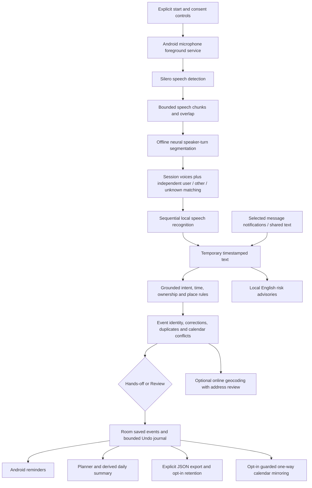

# SideKick prototype architecture

## Boundaries and invariants

- `core` is pure Kotlin: segmentation, dates, intent validation, ownership/context,
  changes, summaries, retention policy, model-pack validation and risk grammar.
- `app` owns Android capture/services, permissions, native inference, Room, reminders,
  notification messages, settings and Compose screens. JNI is behind speech/voice
  interfaces; no cloud inference fallback is used.
- Live audio uses 16 kHz PCM, a 16,384-sample recent history, bounded 160,000-sample
  chunks, 4,096-sample pre-roll, 16,000-sample chunk overlap and a two-slot queue.
  Silence and speech thresholds come from the segmenter/VAD. Listening can span
  arbitrarily many chunks; it does not impose a five-minute session limit.
- Inference is sequential and model import shares its maintenance lock. A slow
  or full queue stops with an explicit error instead of silently losing speech.
  Inputs are zeroed after processing/cancellation; the rolling buffer is not an
  audio archive.
- Source capture time and phone timezone anchor dates and later corrections.
  Other and unknown voices cannot establish personal ownership. Unsupported or
  conflicting dates stay unknown rather than creating guessed reminders.
- Reminder writes, alarms, Undo and retention share a serialization lock. Undo
  checks snapshots and tokens so it cannot overwrite a later manual edit.
- Message context is bounded and separated by conversation; duplicate/grouped
  notifications are handled chronologically. No message-history database exists.
- Daily summaries derive from saved events. Temporary highlights are source
  excerpts; optional Qwen assists manual analysis and is not the live planner.
- Normal APK includes English Fast, VAD and speaker models. Optional packs use
  trusted filenames, lengths, SHA-256 and staged atomic replacement. Failed
  imports preserve the old valid pack. Device model storage is not Android backup.

## Recognition and capture health

Adaptive Automatic uses Omnilingual int8; short queue-clear speech may receive a
second acoustic read with an installed language-specific model. Language clues
never supply event facts, and decoders are not selected for producing an event.
French/German/Russian routing measures voiced span, so quiet padding cannot make
a short negative command select the longer-speech route. Models run sequentially.
The runtime reports the last actual backend in the existing voice diagnostics.

Nonblocking PCM capture and assistant dictation detect native errors or five
seconds with no reads. Valid zero-valued PCM remains healthy silence. Permission,
global mute and Android silencing are checked every 250 ms. Revocation clears the
armed recovery state; regranting alone never starts capture. Unexpected failures
post a generic private notification if notification access allows it.
Recognized owner context has one session key independent of anonymous clustering;
text overlap is never merged across changed speaker attribution.

## Failure handling and limits

Microphone/privacy/foreground restrictions, model absence, muted capture, inference
timeouts and overload have visible stopped/error states. Reminder delivery is
inexact and subject to Android permissions and Doze. Assistant recovery helps an
already-enabled session; it cannot bypass force-stop or revoked microphone access.
Neural segmentation does not separate simultaneous voices into individual audio
streams or identify named people. Optional coarse region guidance is limited and
never establishes applicable law or consent. Production store signing remains separate.
Calendar mirroring is opt-in and one-way, with provider-ID/hash recovery and guarded
updates; account-level cloud behavior still needs field evidence.
See VALIDATION.md for software checks and the dated physical measurements in
STREAMING_BENCHMARK.md and ASR_EVALUATION.md.

## Adaptive Android presentation (0.30)

Presentation preferences live in GuidanceSettings, outside Room event data.
Simple and Detailed homes share the same view model, listening service and editor.
Appearance, design, text scale and interface scale are independent. The size adapter preserves the system fontScale and compensates typography with
the original Android forward/inverse font conversion. This avoids text-size
coupling when Compose snapshots density on newer Android versions. Interface zoom never reduces the default touch targets. Preferences
are applied to both the main app and voice setup.

Simple home is an overview: short windows prioritize listening and the detailed
view action. Larger windows also show the next scheduled plan. Advanced diagnostics
remain explicit disclosures. Hiding manual notes removes the writing/add controls
without deleting the current temporary draft or disabling saved-plan review.
