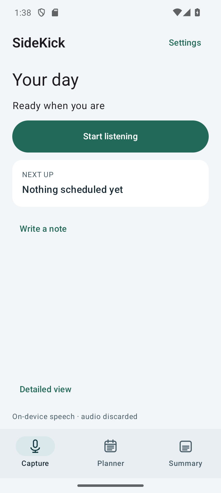
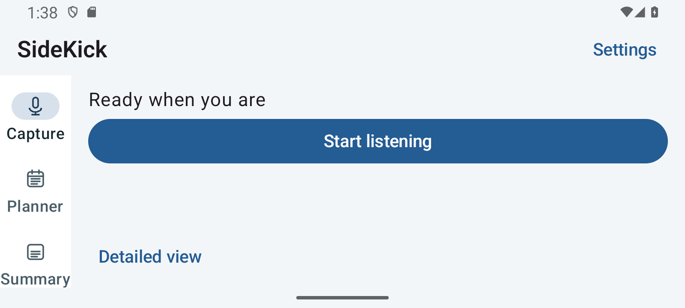
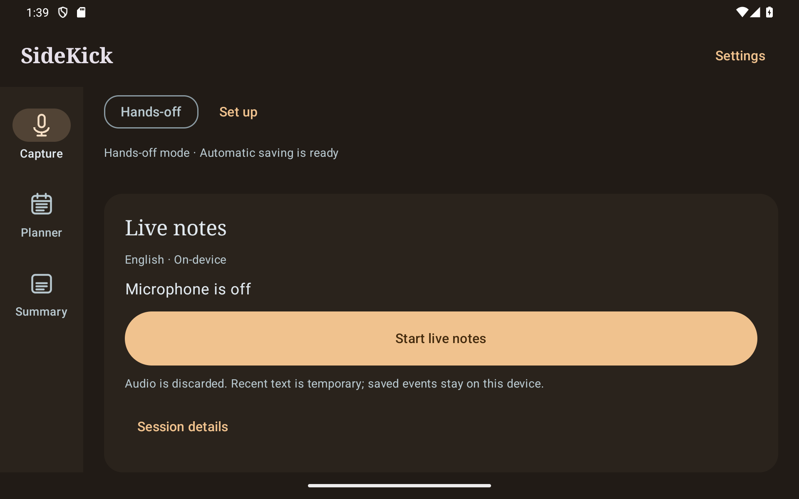

# Interface redesign — November 13, 2026

This is a desk review of official product documentation and design guidance,
not a timed competitor usability study. No paid account, cloud processing or
competitor code is part of SideKick. iPhone work was excluded at the user's request.

| Reference | Observed pattern | Applied to SideKick |
|---|---|---|
| [Notta mobile home](https://support.notta.ai/hc/en-us/articles/17604467003803-Introduction-about-Notta-App) | Home/search, direct capture/import actions, separate settings | Clear listening action; import/model details moved behind explicit controls |
| [Otter conversation layout](https://help.otter.ai/hc/en-us/articles/21695002816535-Learn-about-the-new-Conversation-page-layout) | Separate Summary and Transcript views | Stable Capture / Planner / Summary destinations; source text stays separate from saved facts |
| [Google Recorder](https://support.google.com/pixelphone/answer/16267698) | Distinct transcript editing and summary workflows | Optional note editing, concise recent suggestions and access to full Planner |
| [Android adaptive navigation](https://developer.android.com/develop/adaptive-apps/guides/build-adaptive-navigation) | Bottom navigation for compact windows, rail for larger windows | Bottom bar below 600 dp usable width; side rail at or above it |
| [Android adaptive layout guidance](https://developer.android.com/design/ui/mobile/guides/layout-and-content/adapt-layout) | Adapt to the current window, including resizing | Bounded reading width, system insets, keyboard handling, wrapping controls and scrollable settings |
| [Samsung display controls](https://www.samsung.com/us/support/answer/ANS10001572/) | Separate font, display-size and appearance settings | Independent in-app text and interface sizing; Light/Dark/System |
| [Samsung Easy Mode](https://www.samsung.com/ae/support/mobile-devices/using-easy-mode-on-my-samsung-phone/) | A simpler presentation with larger targets and spacing | Simple home for daily use, Detailed home for notes and technical controls |
| [Todoist board layout](https://www.todoist.com/help/todoist/features/use-the-board-layout-in-todoist-AiAVsyEI) | Alternative views of the same tasks | Both home layouts use the same saved plans and settings |

Otter's referenced page describes its documented conversation layout and notes
that mobile changes are still rolling out. It informs the information hierarchy;
it is not evidence of identical mobile screens or measured usability superiority.
Samsung Easy Mode is a system-level reference, not a competing note-taking app.
SideKick's controls are app-local and never change Android's display preferences.

## Design decisions

- One primary listening action, explicit microphone state and persistent navigation.
- Neutral surfaces, restrained teal, consistent rounded cards and standard Android typography.
- Light, Dark and System appearance choices, saved on the device; text follows
  Android font settings with optional 90/100/115/130% text adjustment. Interface
  controls and spacing independently use 100/110/125%; touch targets never shrink
  below the phone-default size. Android font conversion is delegated to the
  original density, retaining nonlinear scaling on supported versions.
- Calm (teal/rounded), Classic (blue/crisper) and Warm (amber/serif headings)
  design presets work with either Light or Dark appearance.
- Simple home keeps listening, a next-plan preview and a detailed-view action
  together. On short windows or very large text it prioritizes the listening
  controls. Detailed home includes notes, transcript previews and expandable tools.
- Manual note-taking can be switched off independently; review/edit remains
  available and hiding the panel does not delete an existing temporary draft.
- Capture previews three recent suggestions; Planner retains the full history.
- Session diagnostics, audio import and optional model administration are disclosed
  on demand. Consent, stopped/error states and uncertain ownership remain visible.
- Settings open to six short categories: Display, Listening, Plans & reminders,
  Messages & places, Privacy & saved data, and Advanced & help. Each category
  has its own scrollable page and fixed Back/Close controls. Technical model
  choices and phone diagnostics are kept in Advanced.
- Listening exposes an Auto-detect language switch for language changes throughout
  the day. Turning it on selects the existing Adaptive recognition route; turning
  it off restores the previous manual language. Changes wait until listening ends.
- The listening explanation is brief, with optional details and a saved “Don’t
  show this again” checkbox. Cancel does not save that checkbox. Settings →
  Listening can restore the reminder. Hiding it does not start the microphone.
- Source evidence in list cards is a short preview. The editor retains full evidence.

## Compatibility scope

The interface adapts to available space; it does not check for a Pixel brand/model.
The existing native build supports Android 8/API 26 or newer on ARM64 phones and
x86-64 emulator devices. This release does not add a 32-bit native build or iOS.
Microphone access is optional for typed/Planner/Summary workflows. Device RAM,
microphone hardware, Android background policy and optional model sizes still
limit speech capabilities. Responsive layout is not a promise that every offline
model runs smoothly on every low-memory phone.

## Verification

`ResponsiveInterfaceTest` checks persistent navigation, draft preservation,
appearance persistence, optional details, actual window-dependent navigation and
48 dp primary targets without starting the microphone. The reproducible
`scripts/test_interface_layouts.ps1` matrix uses an isolated emulator package,
changes actual display size/density/font scale and restores those settings.
Screenshots contain only synthetic/empty test-app content, not personal data.
See VALIDATION.md for measured outcomes and the exact matrix.

## Screenshots from the verified layout matrix

Synthetic/empty emulator data only. These are actual app screenshots.

## Plain-language review — November 13, 2026

This second desk review uses current official help pages, not a usability study
or a claim that competitor recognition works the same way as SideKick.

| App/reference | Documented pattern | SideKick wording/action |
|---|---|---|
| [Pixel Recorder](https://support.google.com/pixelphone/answer/16267698?hl=en) | A transcription language setting with Detect language; editing is a separate action | Auto-detect stays under Listening; descriptions explain switching languages without backend names. Recorder documents a most-spoken-language limitation, so its behavior is not claimed as SideKick's behavior. |
| [Notta mobile](https://support.notta.ai/hc/en-us/articles/42979225735195-Bilingual-transcription-translation-Mobile-App) | Bilingual settings use a language control and remember the previous choice | Remember settings, keep the language action clear. SideKick still detects per segment without requiring a selected pair or translation subscription. |
| [Todoist reminders](https://www.todoist.com/help/todoist/features/introduction-to-reminders-9PezfU) | Reminder settings name the outcome, such as Automatic reminders, then expose choices | Save plans automatically, Reminder alerts, and Leave it unknown replace implementation terms. |

The copy pass covers Display, Listening, Plans, Messages/Places, Calendar,
Privacy, setup and Advanced. Technical explanations are available under details;
backend names and licenses remain available with speech files/voice model details.
Privacy essentials stay beside the relevant action: online place lookup, message
preview scope, calendar account sharing, permanent cleanup and exported-file sync.
The app does not imply that voice matching proves consent, that all languages are
perfectly recognized, or that a larger model is always more accurate.

Examples from the second wording pass:

| Before | Now |
|---|---|
| Interface size | Buttons & spacing |
| Manual note-taking | Type notes |
| Retention | Keep saved plans |
| Local risk advisories | Scam warnings (explicitly English-only and fallible) |
| Automatically mirror saved activities | Copy plans automatically |
| Separate speaker turns locally | Label different speakers |
| Resume enabled listening after system restart | Resume listening after a restart |

Model selection shows Recommended / Faster / Larger model, with an explicit
warning that a larger model can be slower without always improving accuracy.
Auto-detect also selects Recommended when chosen in setup, matching Listening.
Saved preference codes and functionality remain compatible with existing data.
